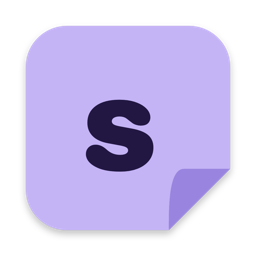
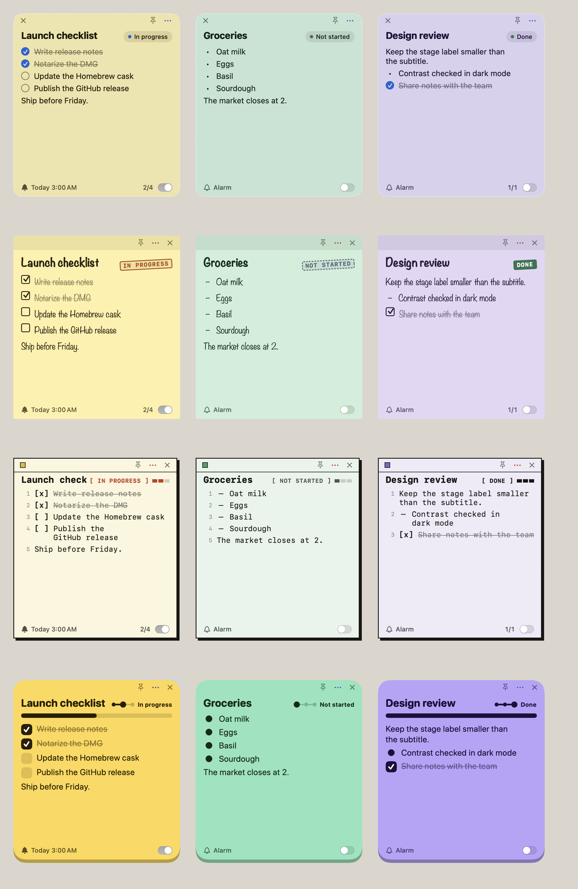

  

<h1 align="center">Sticco</h1>

  <b>오래도록 곁에 붙어 있는 작은 메모.</b> 
  Mac을 위한 무료 오픈소스 스티커 메모 앱

  <a href="https://github.com/tail-s/sticco/releases/latest"><b>⬇︎ macOS용 다운로드</b></a>
  &nbsp;·&nbsp; <a href="README.md">English</a> &nbsp;·&nbsp; 한국어

## 이런 앱이에요

- **메모가 바탕화면에 붙어 있어요.** 메모 하나하나가 작은 창이라, 잘 보이는 곳에 두거나 항상 위에 고정할 수 있어요.
- **할 일이 어디까지 왔는지 보여요.** 메모마다 소제목과 진행 단계(*시작 전 → 진행 중 → 완료*)가 붙어요. 단계를 누르면 다음 단계로 넘어가요.
- **메뉴 없이 체크리스트.** 줄 앞에 `[ ]`를 쓰면 체크박스, `-`를 쓰면 글머리 기호가 돼요. 나머지는 그냥 글이에요.
- **놓치지 않게 알려 줘요.** 메모마다 알림을 걸 수 있어요. 한 번, 매일, 평일, 매주 중에서 고르세요.
- **한눈에 모아 보기.** 대시보드에서 모든 메모를 보드나 목록으로 보고, 검색하고, 걸러 볼 수 있어요.
- **내 취향대로.** Glass, Paper, Ink, Pop 네 가지 테마와 여섯 가지 글꼴, 라이트·다크 모드를 지원해요.
- **우리말로.** 한국어, English, 日本語를 언제든 바꿀 수 있어요.
- **내 Mac에만 저장돼요.** 계정도, 클라우드도, 추적도 없어요.

## 설치

1. [최신 **Sticco.dmg** 다운로드](https://github.com/tail-s/sticco/releases/latest)
2. 파일을 열고 **Sticco**를 **응용 프로그램** 폴더로 끌어다 놓으세요.
3. 응용 프로그램 폴더나 Launchpad에서 Sticco를 여세요.

macOS 14 Sonoma 이상이 필요하고, Apple 실리콘과 Intel Mac 모두에서 동작해요.

## 사용법

| 이렇게 하려면 | 이렇게 하세요 |
|---|---|
| 새 메모 만들기 | 어디서든 **⌥⌘N**, 또는 메뉴 막대 아이콘 → **새 메모** |
| 체크리스트 쓰기 | 줄을 `[ ]`로 시작하고, 상자를 누르면 체크돼요 (`[x]`) |
| 글머리 기호 | 줄을 `- `로 시작하세요 |
| 글 고치기 | 메모 글을 누르고, 다 쓰면 **Esc**를 누르거나 다른 곳을 누르세요 |
| 진행 단계 바꾸기 | 단계 라벨을 누르거나, 오른쪽 클릭해서 고르세요 |
| 알림 걸기 | 메모 아래쪽 종 모양을 누르고 시간과 반복을 고르세요 |
| 항상 위에 두기 | 핀을 누르세요 |
| 색상 바꾸기 | **⋯** → 색상 |
| 메모 치워 두기 | **×**를 누르면 대시보드에 남아 있어요. 대시보드에서 두 번 누르면 다시 떠요 |
| 대시보드 열기 | **⌘0**, 메뉴 막대 아이콘, 또는 Dock의 Sticco 클릭 |

처음 알림을 켜면 macOS가 알림을 허용할지 물어봐요. **허용**을 눌러야 알림이 와요.
나중에 **시스템 설정 → 알림 → Sticco**에서 바꿀 수 있어요.

## 취향대로 꾸미기

**설정**(⌘,)을 여세요.

- **일반**: 언어, 라이트·다크 모드, 로그인 시 열기, 알림 소리
- **화면**: 테마와 글꼴 테마 고르기
- **진행 단계**: 단계 이름 바꾸기, 순서 바꾸기, 새 단계 추가(예: *대기 중*)

| Glass | Paper | Ink | Pop |
|---|---|---|---|
| 맑고 차분한, Mac 기본 앱 같은 느낌 | 진짜 포스트잇 종이, 손글씨 느낌 | 흑백의 텍스트 중심 | 밝고 경쾌한 칸반 |

나만의 테마도 만들 수 있어요. 파일 하나면 돼요. [테마 만드는 법](docs/THEMES.md)을 보세요.

## 자주 묻는 질문

**메모는 어디에 저장되나요?**
내 Mac의 `~/Library/Application Support/Sticco/notes.json`에 저장되고, 어디로도 전송되지 않아요.
백업하려면 이 파일을 복사해 두세요.

**메모를 닫았는데 없어졌나요?**
아니요. 바탕화면에서만 치워진 거예요. 대시보드에서 찾아 두 번 누르세요.

**알림 소리가 안 나요.**
**시스템 설정 → 알림 → Sticco**와 Sticco의 **설정 → 일반 → 알림 소리**를 확인해 주세요.

**지우려면 어떻게 하나요?**
Sticco를 종료하고 응용 프로그램 폴더에서 휴지통으로 옮기세요. 메모까지 지우려면
`~/Library/Application Support/Sticco` 폴더도 지우면 돼요.

**안 되는 게 있거나 아이디어가 있어요.**
[이슈를 남겨 주세요](https://github.com/tail-s/sticco/issues). 어떤 의견이든 환영해요.

## 개발자라면

Sticco는 Swift와 SwiftUI로 만들었어요. 직접 빌드하거나 기여하거나 릴리스하는 방법은
[docs/DEVELOPMENT.md](docs/DEVELOPMENT.md)에 있어요.

## 라이선스

Sticco는 [MIT 라이선스](LICENSE)의 무료 소프트웨어예요. 함께 들어 있는 글꼴은 SIL Open Font License 1.1을 따라요.
