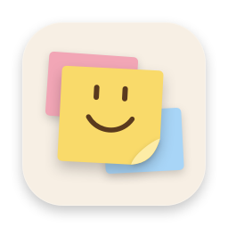
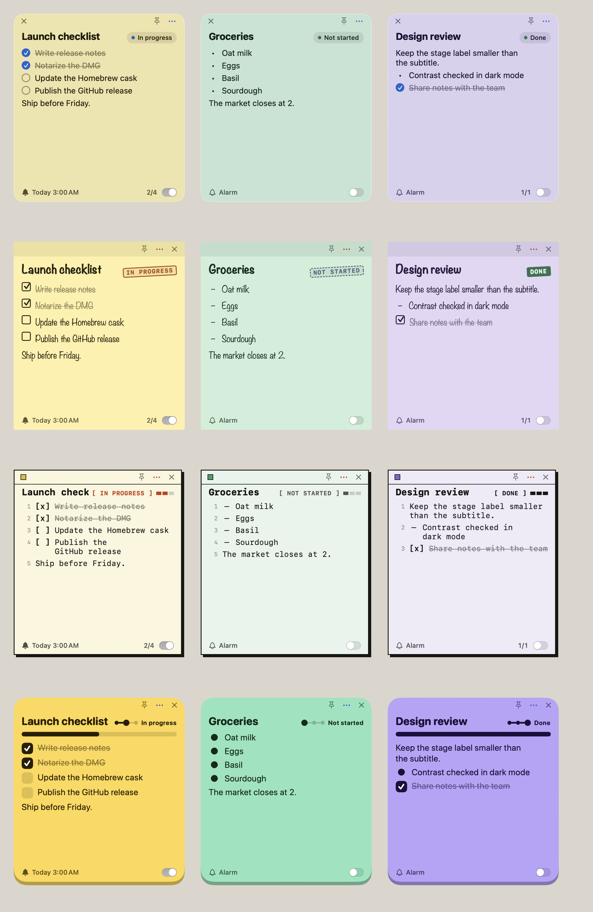

  

<h1 align="center">Sticco</h1>

  <b>Little notes that stick around.</b> 
  Free, open-source sticky notes for your Mac.

  <a href="https://github.com/tail-s/sticco/releases/latest"><b>⬇︎ Download for macOS</b></a>
  &nbsp;·&nbsp; English &nbsp;·&nbsp; <a href="README.ko.md">한국어</a>

## Why Sticco

- **Notes live on your desktop.** Every note is its own little window. Leave it where you'll see it, or pin it above everything else.
- **Know where each task stands.** Each note shows a short subtitle and a stage: *Not started → In progress → Done*. Click the stage to move it along.
- **Checklists without menus.** Start a line with `[ ]` for a checkbox or `-` for a bullet. Everything else is plain text.
- **Never miss it.** Give any note an alarm — once, every day, on weekdays, or every week.
- **See everything at once.** The dashboard shows all notes as a board or a list, with search and filters.
- **Make it yours.** Five looks — Default, Glass, Paper, Ink and Pop — six font styles, light and dark mode.
- **Speaks your language.** English, 한국어 and 日本語, switchable any time.
- **Private by design.** No account, no cloud, no tracking. Your notes stay on your Mac.

## What's new

**0.1.1** — a new Default theme, a truly see-through Glass theme, settings inside the dashboard, a fresh icon,
and fixes for moving and editing notes. See the [full changelog](CHANGELOG.md).

## Install

1. [Download the latest **Sticco.dmg**](https://github.com/tail-s/sticco/releases/latest).
2. Open it and drag **Sticco** into the **Applications** folder.
3. Open Sticco from Applications or Launchpad.

Needs macOS 14 Sonoma or later. Works on Apple silicon and Intel Macs.

## Getting started

| To… | Do this |
|---|---|
| Create a note | Press **⌥⌘N** anywhere, or click the menu bar icon → **New Note** |
| Write a checklist | Start lines with `[ ]` — click the box to tick it (`[x]`) |
| Add bullets | Start lines with `- ` |
| Edit text | Click the note's text; press **Esc** or click elsewhere when you're done |
| Change the stage | Click the stage label, or right-click it to pick one |
| Set an alarm | Click the bell at the bottom of the note, choose a time and how often |
| Keep a note on top | Click the pin |
| Change the color | Click **⋯** → Color |
| Put a note away | Click **×** — it stays in the dashboard, double-click it to bring it back |
| Open the dashboard | **⌘0**, the menu bar icon, or click Sticco in the Dock |

When you turn on your first alarm, macOS asks whether Sticco may send notifications. Choose **Allow** so alarms can reach you.
You can change this later in **System Settings → Notifications → Sticco**.

## Make it yours

Open **Settings** with ⌘, or from the bottom of the dashboard sidebar:

- **General** — language, light/dark mode, open at login, alarm sound.
- **Appearance** — pick a theme and a font style.
- **Stages** — rename stages, change their order, or add your own (for example *Waiting*).

| Default | Glass | Paper | Ink | Pop |
|---|---|---|---|---|
| Clean and calm, like a built-in Mac app | See-through notes that let your desktop shine through | Real sticky-note paper, handwritten feel | Black-and-white, plain-text focused | Bright, bold and playful |

Want your own look? A theme is one small file — see [how to make a theme](docs/THEMES.md).

## Questions

**Where are my notes saved?**
In `~/Library/Application Support/Sticco/notes.json` on your Mac. Nothing is sent anywhere.
To back up your notes, copy that file.

**I closed a note. Is it gone?**
No. Closing only takes it off the desktop. Find it in the dashboard and double-click it.

**The alarm didn't make a sound.**
Check **System Settings → Notifications → Sticco**, and that **Settings → General → Alarm sound** is on.

**How do I uninstall Sticco?**
Quit Sticco, move it from Applications to the Trash, and delete the folder
`~/Library/Application Support/Sticco` if you also want to remove your notes.

**Something isn't working, or I have an idea.**
Please [open an issue](https://github.com/tail-s/sticco/issues) — feedback is very welcome.

## For developers

Sticco is written in Swift and SwiftUI. To build it yourself, contribute, or publish a release, see
[docs/DEVELOPMENT.md](docs/DEVELOPMENT.md).

## License

Sticco is free software under the [MIT License](LICENSE). Bundled fonts use the SIL Open Font License 1.1.
